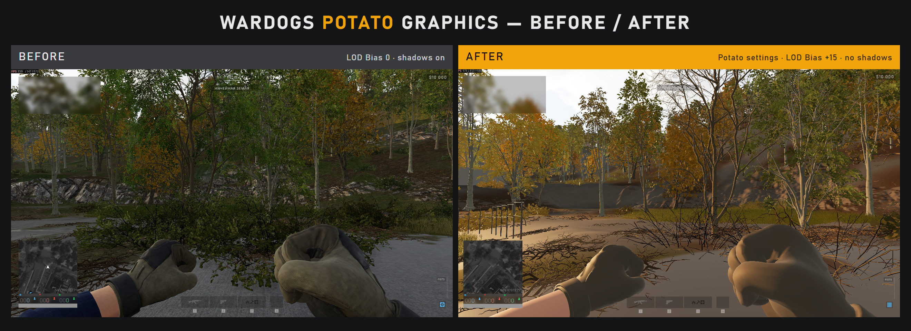
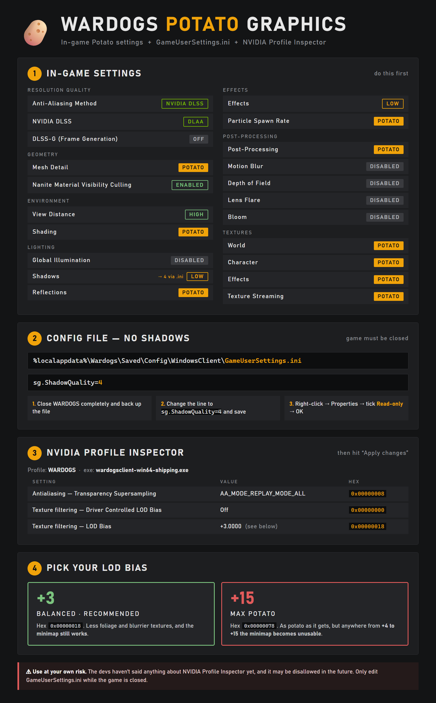

**English** | [Русский](README.ru.md) | [Українська](README.uk.md) | [Deutsch](README.de.md)

# WARDOGS Potato Graphics Guide 🥔

Ultra-low ("potato") graphics for **WARDOGS**: in-game Potato settings, one `GameUserSettings.ini` line, and **LOD Bias** through **NVIDIA Profile Inspector**.

**TL;DR:** Potato in-game settings → `sg.ShadowQuality=4` in GameUserSettings.ini (set to read-only) → NVIDIA Profile Inspector with LOD Bias **+3**. You end up with no shadows, much less foliage and flat, low-detail textures.

*Last updated: 2026-10-27. The game is still getting updates, so settings may change.*

*The "after" screenshot uses the max LOD Bias of +15. The recommended value is +3 ([why](#which-lod-bias-should-i-use)).*

> ⚠️ **Use at your own risk.** The devs haven't said anything about NVIDIA Profile Inspector so far, and they may disallow it in the future. If that happens, roll everything back (see [How to undo](#how-to-undo)).

---

## What you need

* An **NVIDIA GPU**. NVIDIA Profile Inspector only works with NVIDIA drivers. Steps 1–2 work on any GPU.
* **NVIDIA Profile Inspector** (NPI) from the official GitHub: https://github.com/Orbmu2k/nvidiaProfileInspector/releases
* About 10 minutes

---

## Step 1: In-game settings

Open the game's graphics settings and set everything as below. **Overall Quality** will show **Custom**, which is expected.

| Setting | Value |
|:--|:--|
| **RESOLUTION QUALITY** | |
| Anti-Aliasing Method | NVIDIA DLSS |
| NVIDIA DLSS | DLAA |
| DLSS-G (DLSS Frame Generation) | Off |
| **GEOMETRY** | |
| Mesh Detail | Potato |
| Nanite Material Visibility Culling | Enabled |
| **ENVIRONMENT** | |
| View Distance | High |
| Shading | Potato |
| **LIGHTING** | |
| Global Illumination | Disabled |
| Shadows | Low *(Step 2 turns them off completely)* |
| Reflections | Potato |
| **EFFECTS** | |
| Effects | Low |
| Particle Spawn Rate | Potato |
| **POST-PROCESSING** | |
| Post-Processing | Potato |
| Motion Blur | Disabled |
| Depth of Field | Disabled |
| Lens Flare | Disabled |
| Bloom | Disabled |
| **TEXTURES** | |
| World | Potato |
| Character | Potato |
| Effects | Potato |
| Texture Streaming | Potato |

**Apply the settings, then close the game completely.** You have to do Step 2 with the game closed.

---

## Step 2: Turn shadows off completely (GameUserSettings.ini)

The lowest shadow setting in the menu is Low, but the config file can go further.

1. Make sure WARDOGS is **fully closed**. Never edit this file while the game is running.
2. Press **Win + R**, paste `%localappdata%\Wardogs\Saved\Config\WindowsClient` and press **Enter**.
3. **Back up** the file: copy **GameUserSettings.ini** somewhere safe, like your Desktop.
4. Open **GameUserSettings.ini** with Notepad, press **Ctrl + F** and search for `sg.ShadowQuality`.
5. Change that line to `sg.ShadowQuality=4`, then save and close Notepad.
6. Right-click **GameUserSettings.ini** → **Properties** → tick **Read-only** → **OK**. This stops the game from overwriting your change.

> 💡 While the file is read-only, nothing you change in the in-game settings menu will be saved. To change something later: untick Read-only → change it in game → close the game → repeat steps 4–6.

---

## Step 3: NVIDIA Profile Inspector (LOD Bias)

LOD Bias forces the game to use lower-detail versions of its textures. Textures get blurrier and foliage thins out.

Download NPI from the GitHub link above, unzip it and run `nvidiaProfileInspector.exe`.

### Option A: import a ready profile (easiest)

1. Download one of these profiles. Open the file and click **Download raw file**.
    * [`WARDOGS_potato_LOD3_balanced.nip`](profiles/WARDOGS_potato_LOD3_balanced.nip) (**recommended**, LOD Bias +3)
    * [`WARDOGS_potato_LOD15_max.nip`](profiles/WARDOGS_potato_LOD15_max.nip) (max potato, LOD Bias +15, breaks the minimap)
2. In NPI, click **Import user defined profiles** in the toolbar and pick the `.nip` file.
3. Click **Apply changes** (top right).

### Option B: set it up manually

1. In the **Profiles** box at the top, type `WARDOGS` and select the profile.
    * No WARDOGS profile? Click **Create new profile** and name it `WARDOGS`. Then click **Add application to current profile** and select `wardogsclient-win64-shipping.exe` from the game's install folder. On Steam, you can find that folder with right-click WARDOGS → Manage → Browse local files.
2. Change the three settings from the table below. Either pick the value from the dropdown or type the hex value in.
3. Click **Apply changes** (top right).
4. If the game was running, restart it.

| Setting | Value | Hex |
|:--|:--|:--|
| Antialiasing - Transparency Supersampling | AA_MODE_REPLAY_MODE_ALL | `0x00000008` |
| Texture filtering - Driver Controlled LOD Bias | Off | `0x00000000` |
| Texture filtering - LOD Bias | +3 *(see below)* | `0x00000018` |

The first two settings make the driver actually apply your LOD Bias value. Without them, the third one does nothing.

---

## Which LOD Bias should I use?

| LOD Bias | Hex | Result |
|:--|:--|:--|
| **+3** | `0x00000018` | **Recommended.** Good balance between playability and advantage. The minimap still works. |
| +4 to +15 | — | ❌ The minimap becomes unusable. |
| +15 | `0x00000078` | Max potato. This is the "after" screenshot. |

**TL;DR: use +3** unless you're fine with playing without a minimap.

---

## How to undo

* **NPI:** select the WARDOGS profile → click **Restore current profile to NVIDIA defaults** → **Apply changes**.
* **Shadows:** with the game closed, untick **Read-only** on GameUserSettings.ini and put your backup back.
* **In-game:** pick any preset in **Overall Quality**.

---

## Known issues

* **The minimap is unusable**: your LOD Bias is above +3. Set it back to +3 (`0x00000018`).
* **In-game settings won't save**: GameUserSettings.ini is still read-only from Step 2. That's expected.
* **AMD / Intel GPU**: NPI is NVIDIA-only, but Steps 1–2 still work.

---

## Cheat sheet

